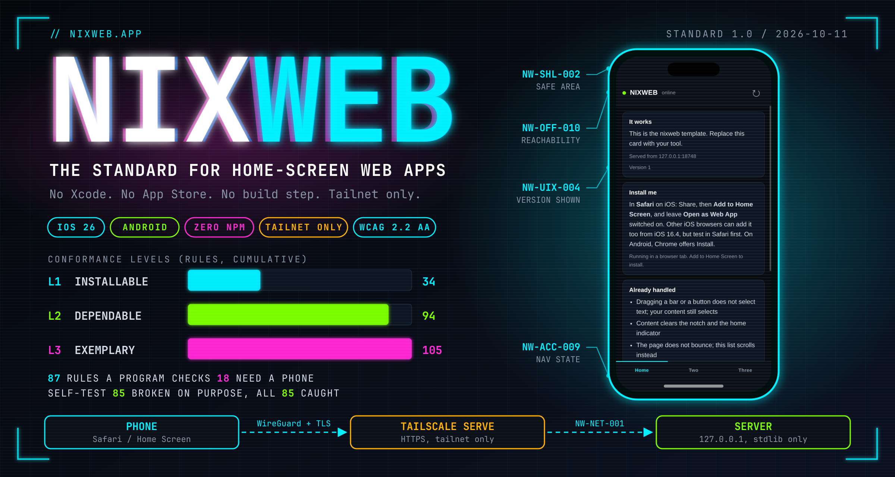
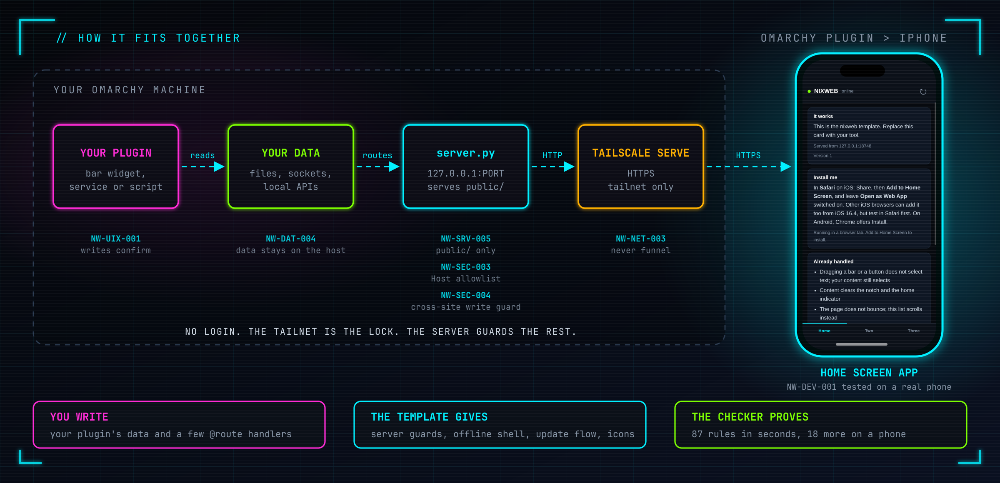

<h1 align="center">nixweb.app</h1>

<p align="center"><b>The standard for building iPhone apps as web apps, for people who live on Omarchy.</b><br>
A template, a 105-rule standard, and a checker that tells you exactly which rules your app breaks.<br>
No Xcode. No developer account. No App Store. No review.</p>

<p align="center"><code>NixWeb Standard 1.0</code> &nbsp;|&nbsp; <code>105 rules</code> &nbsp;|&nbsp; <code>87 checked by a program</code> &nbsp;|&nbsp; <code>3 levels</code> &nbsp;|&nbsp; <code>Omarchy + Tailscale + iPhone</code></p>

---

## Why this exists

**I wanted to set up standards for Omarchy folks who make apps that work on the iPhone with their plugins.**

Omarchy people build plugins: bar widgets, panels, services. Those plugins hold the numbers you
actually want when you are away from the desk. How much quota is left, which agent is waiting on
you, what the lights are doing. Today that lives on a laptop and a screen you are not looking at.

The usual road to a phone app is Xcode, signing and review. The web road is a page on the Home
Screen, and it is real: its own icon, its own window, its own slot in the app switcher. But it
breaks in quiet ways nobody warns you about. It looks right in a simulator and clips under the notch
on the phone. It ships an update that changes nothing. It serves your `.git` folder to everyone on
your network. My first template bound to every network interface and 404'd its own health check, and
I did not notice until a fresh app told me it could not reach home.

So I wrote the standard, the checker and the template I wanted to be handed. A plugin author can
ship a phone companion that is correct, and anyone, human or AI agent, can be told precisely when it
is not.

> A community project by Fred Nix. It is not part of Omarchy.

---

## Who it is for

- **Omarchy plugin authors** who want a pocket companion for their plugin, reachable from the sofa,
  the car or a coffee shop, and nowhere else.
- **Anyone building a private web app** on a machine they own, who wants it to feel like an app.
- **AI coding agents.** The template ships an `AGENTS.md`. Tell an agent to build from it, run
  `nixweb check`, and treat a failing MUST as a bug.

---

## How it fits together



1. Your plugin already has the data. Give the server a way to read it: a file, a socket, a local API.
2. The server is standard-library Python on `127.0.0.1`. It serves one folder and a few `@route` handlers.
3. `tailscale serve` puts HTTPS in front of it, for your tailnet and nowhere else.
4. On the iPhone: Share, **Add to Home Screen**, leave **Open as Web App** on.

You write the routes. The template gives you the server guards, the offline shell, the update flow
and the icons. The checker proves the rest.

---

## Install

You need Tailscale installed and signed in on the machine, with HTTPS enabled for your tailnet in the
admin console. You need Python 3 for the server and the checker, ImageMagick for `nixweb icons`, and
systemd user services for `nixweb install`. There is nothing to build and nothing from npm.

```bash
git clone https://github.com/nixfred/nixweb.app ~/Projects/nixweb.app
export PATH="$HOME/Projects/nixweb.app/bin:$PATH"     # put this in your shell profile
```

---

## Your first phone companion

```bash
nixweb new pocket-plugin            # copies the template to ~/Projects/pocket-plugin
nixweb icons pocket-plugin PP       # your own two letters on a real icon
```

**1. Give the server your plugin's data.** The simplest bridge is a JSON file your plugin writes.
Add a route to `server.py`, just above `if __name__ == "__main__":`

```python
STATUS_FILE = os.environ.get("PLUGIN_STATUS", os.path.expanduser("~/.local/state/myplugin/status.json"))


@route("GET", "/api/status")
def status(_):
    try:
        with open(STATUS_FILE) as f:
            return 200, json.load(f)
    except (OSError, ValueError):
        return 503, {"error": "the plugin has not written a status yet"}
```

**2. Show it on the page.** Add a card to `public/index.html`

```html
<section class="card" aria-labelledby="h-plugin">
  <h2 id="h-plugin">My plugin</h2>
  <p id="plugin">loading</p>
</section>
```

and a few lines to `public/app.js`. `textContent`, never `innerHTML`, and every fetch has a timeout:

```js
function showStatus() {
  nwFetch('api/status', { cache: 'no-store' }, 4000)
    .then(function (r) { return r.json(); })
    .then(function (s) { byId('plugin').textContent = s.summary || s.error || 'no data'; })
    .catch(function () { byId('plugin').textContent = 'no answer from the host'; });
}
showStatus();
setInterval(showStatus, 20000);
```

**3. Check it.** This example was run: the app still has no failures at Level 2.

```bash
nixweb check pocket-plugin
```

**4. Serve it and put it on the phone.**

```bash
nixweb serve pocket-plugin 8731     # prints the phone URL. Ctrl-C removes the tailnet mapping
nixweb install pocket-plugin 8731   # a systemd user unit, so it survives a reboot
```

Open the printed URL on the iPhone, Share, **Add to Home Screen**. Pick the host name and port you
mean to keep first: an installed app is bound to its origin, and changing either makes a new app.

**Reads are free. Writes confirm.** If your companion can change something, such as start a job or
send a prompt, that is a write. It shows what it will do and waits for a tap, it carries an
idempotency key so a retry cannot repeat it, and it queues offline in IndexedDB. The standard says
exactly how (NW-UIX-001, NW-DAT-001, NW-DAT-002).

---

## The standard

[STANDARD.md](STANDARD.md) is the NixWeb Standard 1.0: **105 rules in three levels.** Every rule has
a permanent ID, a requirement word (MUST, SHOULD or MAY), the reason it exists with its source, and
the exact test. It was written from primary sources on 2026-10-11: WebKit and Apple release notes,
MDN, W3C, web.dev, OWASP and Tailscale's own documentation.

| Level | Name | Rules, cumulative | What it means |
|---|---|---|---|
| 1 | Installable | 34 | It installs, it is safe on a tailnet, and nothing basic is broken. |
| 2 | Dependable | 94 | It keeps working when the host is asleep, the network is gone, an update lands mid-session or a hostile page is open in the browser. |
| 3 | Exemplary | 105 | It is proven: a person ran it on a real phone with VoiceOver, the numbers are recorded, and a claim is published. |

**87 of the 105 rules are checked by a program,** `nixweb check`, which needs only Python 3. The other
18 need a person holding a phone, and [standard/CHECKLIST.md](standard/CHECKLIST.md) lists them. An
automated pass is not a conformance claim.

### What the rules cover

| Area | Rules | What it keeps you out of |
|---|---|---|
| Architecture | 3 | A build step, a framework, unrecorded vendored code |
| Network and hosting | 7 | Reachable beyond Tailscale, an accidental funnel, an installed app orphaned by a rename |
| Server | 11 | Serving `.git`, wrong MIME types, stale caches, broken media, a server that will not stop |
| Security and privacy | 9 | DNS rebinding, cross-site writes, third-party scripts, injected HTML, secrets in the page |
| Installability | 8 | A missing manifest id, blank or transparent icons, the iOS 26 status bar bug |
| Shell and layout | 10 | Content under the notch, a bouncing page, input zoom, a keyboard that covers the field |
| iOS behaviour | 4 | A wrong "am I installed" check, user-agent sniffing, state lost on suspend |
| Offline and resilience | 13 | An error page instead of your app, an update that ships nothing, a hung request, a white screen |
| Data and storage | 5 | Lost offline writes, duplicated retries, state that lives only on the phone |
| Interface behaviour | 4 | Writes with no confirmation, empty screens that look broken, no way back |
| Accessibility | 13 | Disabled zoom, unnamed controls, no focus ring, low contrast |
| Performance | 4 | A heavy first load, render-blocking scripts, layout shift |
| Documentation and evidence | 5 | Quirk fixes nobody can explain, a claim with nothing behind it |
| Device verification | 9 | Everything that only a real phone can tell you |

### The ten that bite first

| Rules | What goes wrong | The fix |
|---|---|---|
| NW-SHL-001, -002 | Looks right in a simulator, clips under the notch on the phone | `viewport-fit=cover`, and add the safe-area inset to real padding |
| NW-OFF-007, NW-SRV-006 | You bump the version and nothing changes | Precache with `cache: 'reload'`, serve `no-cache` |
| NW-SRV-005 | Your `.git` or `.env` is served to the tailnet | Serve only `public/`, from an allowlist |
| NW-SEC-003, -004 | A web page in your own browser talks to your app | Host allowlist and a cross-site write guard |
| NW-NET-001, -003 | The app is reachable beyond Tailscale | Bind `127.0.0.1`, never run `tailscale funnel` |
| NW-OFF-006 | A failed script request gets `index.html` back | Fall back to the shell for navigations only |
| NW-INS-005 | Black corners or a monogram as the Home Screen icon | An opaque 180x180 `apple-touch-icon` |
| NW-ACC-001, NW-SHL-005 | Zoom disabled and the audit fails, or iOS zooms on focus | Drop `user-scalable=no`, make inputs 16px |
| NW-DAT-004 | State set up in Safari is missing in the installed app | They do not share storage. Set up on the host |
| NW-IOS-001 | "Am I installed?" says false inside the installed app | Test `standalone`, `fullscreen` and `navigator.standalone` |

### What a pass looks like

The template, copied as `mytool`:

```
nixweb check  mytool   NixWeb 1.0.0   target Level 2 (Dependable)

Level 1  Installable   34 rules: 33 pass, 0 fail, 0 warn, 0 not verified, 0 not applicable, 1 need a person

Level 2  Dependable   60 rules: 42 pass, 0 fail, 0 warn, 1 not verified, 6 not applicable, 11 need a person
  ? NW-NET-004 SHOULD The service comes back after a reboot
      no nixweb-mytool.service on this host (run nixweb install if the app should survive a reboot)

No automated failures for Level 2. 1 rule(s) could not be verified.  12 rule(s) need a person with a phone: see standard/CHECKLIST.md, or run again with --manual. An automated pass is not a conformance claim.
```

### What a failure looks like

A copy with `user-scalable=no` added and `innerHTML` assigned:

```
nixweb check  notes   NixWeb 1.0.0   target Level 1 (Installable)

Level 1  Installable   34 rules: 31 pass, 2 fail, 0 warn, 0 not verified, 0 not applicable, 1 need a person
  ✗ NW-SEC-007 MUST   No code-injection sinks
      code-injection sink at public/app.js:218
      why: OWASP's DOM XSS cheat sheet names textContent the safe sink. Data from your own notes is still untrusted: it can be pasted or synced from somewhere else.
  ✗ NW-ACC-001 MUST   Zoom is never disabled
      viewport contains user-scalable=no
      why: WCAG 1.4.4 requires text to resize to 200 percent. WebKit has ignored these keys since iOS 10, so on iPhone the tag does nothing and only fails the audit; elsewhere it blocks zoom. The input-zoom problem is solved by NW-SHL-005, not by this tag.

NOT CONFORMANT to Level 1: 2 automated rule(s) failed.  1 rule(s) need a person with a phone: see standard/CHECKLIST.md, or run again with --manual. An automated pass is not a conformance claim.
```

### Why you can trust the checker

The first version of `nixweb check` was a grep, and it passed a template that shipped
`user-scalable=no`. So the checker now has to prove itself. `python3 standard/selftest.py` breaks a
copy of the template once for each automated rule and requires the rule to notice. All 85 rules it
can test are caught. The checker reads HTML with a real parser, decodes the icon PNGs, copies the app
to a temporary folder and plants files that must never be served, and probes your own server with
hostile requests. A rule cannot be added without a test that it can fail.

---

## What the template already handles

| Trap | What it looks like | Handled by |
|---|---|---|
| Text selects while you drag | A blue highlight chasing your thumb | `user-select: none` on bars and buttons only, content stays selectable (NW-SHL-007) |
| Content under the notch | Top row unreadable | `viewport-fit=cover` and `env(safe-area-inset-*)` on all four sides (NW-SHL-001, -002) |
| The whole page bounces | Rubber-band scroll over the entire app | Page fixed, lists scroll in their own box (NW-SHL-003) |
| Default or broken icon | Looks wrong on the Home Screen | Opaque 180px `apple-touch-icon` and manifest icons, checked for blank tiles (NW-INS-004, -005) |
| Host asleep | Safari's error page, so your app looks broken | Service worker shell and a banner that says when it last heard from the host (NW-OFF-001, NW-DEV-002) |
| An update that ships nothing | You bumped the version and the old code runs | `cache: 'reload'` precache, `no-cache` from the server, a user-gated update (NW-OFF-007, NW-SRV-006, NW-OFF-009) |
| `.git` and `.env` readable | Whole history served to the tailnet | The server publishes only `public/` (NW-SRV-005) |
| A web page writes to your app | Nothing, until it does | Host allowlist and cross-site guard (NW-SEC-003, -004) |
| A startup error | A white screen and no console | Error and rejection handlers paint a card (NW-OFF-012) |
| Recording stops when the screen sleeps | Voice features silently fail | Wake Lock, version-aware and documented (NW-IOS-004) |

---

## Where to run it

Start on the machine that already has the data, which for a plugin is your Omarchy machine. The
catch is that when the laptop sleeps, the app is unreachable, and the template says so honestly
instead of failing. Move to an always-on box when "is my laptop awake?" becomes the thing standing
between you and your own tool. Not before: a second machine is something more to patch and one more
place for secrets to live. Details in [docs/02-hosting.md](docs/02-hosting.md).

---

## The hard rule on exposure

**Tailscale only, until you decide otherwise on purpose.**

A tailnet app has no login. The tailnet is the lock. That is right for a personal tool and wrong for
the open internet. The app never listens beyond `127.0.0.1`, and only `tailscale serve` exposes it,
and only to your tailnet.

The tailnet is not the only lock, though. A web page open in a browser on any tailnet device can
still send requests to your app, so the server checks the Host header and refuses cross-site writes.
See [docs/07-security-model.md](docs/07-security-model.md).

`tailscale funnel` puts a service on the public internet in one command. It is also the moment your
personal tool becomes an internet-facing service that needs a login, a rate limit and a threat
model, and a port is either served or funnelled, so one funnel command on a serve port silently
makes it public. Treat it as a decision, never as a convenience. See
[docs/04-https-and-tailscale.md](docs/04-https-and-tailscale.md).

---

## What a web app cannot do

Be honest about this up front, because finding out late is expensive.

- **No App Store listing.** Nobody discovers it. For a personal tool, a feature.
- **Push notifications and badging** work on iOS 16.4 and later **only once added to the Home
  Screen**, and the permission prompt must come from a tap.
- **No Shortcuts intents, no widgets, no Live Activities, no share-sheet target.**
- **No background execution.** It does not run when closed. Background Sync is not in Safari.
- **Not in Safari on iPhone:** Web Bluetooth, WebUSB, Web Serial, WebHID, vibration, orientation lock.
- **Audio capture stops when the screen sleeps.** Playback survives the lock screen. Wake Lock keeps
  the screen on in an installed app from iOS 18.4, and did not work there from 16.4 to 18.3.
- **The Home Screen app does not share storage with Safari.** Do not set anything up in Safari.

If you need the first three, you need a real app. For everything else, this is a better deal.

---

## The guide

| Read | When |
|---|---|
| [docs/01-why-web-apps.md](docs/01-why-web-apps.md) | You are deciding between a web app and a native app |
| [docs/02-hosting.md](docs/02-hosting.md) | You are picking where to run it and how it survives a reboot |
| [docs/03-iphone-gotchas.md](docs/03-iphone-gotchas.md) | You want the iPhone behaviours, with what changed and what is still unverified |
| [docs/04-https-and-tailscale.md](docs/04-https-and-tailscale.md) | You want to know what `tailscale serve` does to a request |
| [docs/05-offline.md](docs/05-offline.md) | You are building the offline shell, updates and the write outbox |
| [docs/06-testing.md](docs/06-testing.md) | You are checking an app, or running the real-device test |
| [docs/07-security-model.md](docs/07-security-model.md) | You want the threat model for an app with no login |
| [STANDARD.md](STANDARD.md) | You want every rule, its reason and its test |
| [standard/CHECKLIST.md](standard/CHECKLIST.md) | You are working through a conformance claim |

---

## Verified, and not verified

Tested here: the template and the checker pass each other. The checker is broken on purpose and
catches it. The template runs in real Chromium under its own Content-Security-Policy with no
unexpected errors, installs its service worker, shows the update prompt when a new version is
deployed, and launches from cache with the server stopped. `nixweb serve` reaches a client over the
real tailnet and removes its mapping on exit.

**Not tested:** a physical iPhone, Android, and `nixweb install`. Nothing here claims otherwise.
Appendix E of the standard lists what only a phone can answer, and `device-test.md` is where the
answers go. If you have a phone and a minute, that is the most useful contribution there is.

---

## Improving the standard

`standard/rules.json` is the source. `STANDARD.md` and the checklist are generated from it, so edit
the JSON and run `nixweb standard --rebuild`. Rule IDs are permanent: never reuse, renumber or
reorder one. A new automated rule needs a mutation in `standard/selftest.py`, and the self-test fails
without one. If you think a rule is wrong, bring the primary source.

---

## Layout

```
STANDARD.md   the standard: rules, reasons, tests (generated from standard/rules.json)
standard/     rules.json (the source), check.py, selftest.py, CHECKLIST.md
template/     the skeleton: public/ (index.html, app.css, app.js, sw.js, manifest, icons),
              server.py, AGENTS.md, CONFORMANCE.md, device-test.md
bin/nixweb    new / icons / serve / install / check / standard / hosts
docs/         the guide, and the images the README uses
CLAUDE.md     rules for an AI working in this repo (AGENTS.md is a link to it)
```

---

<p align="center"><sub>Made by Fred Nix for people building on Omarchy. A community project, not part of Omarchy.</sub></p>
